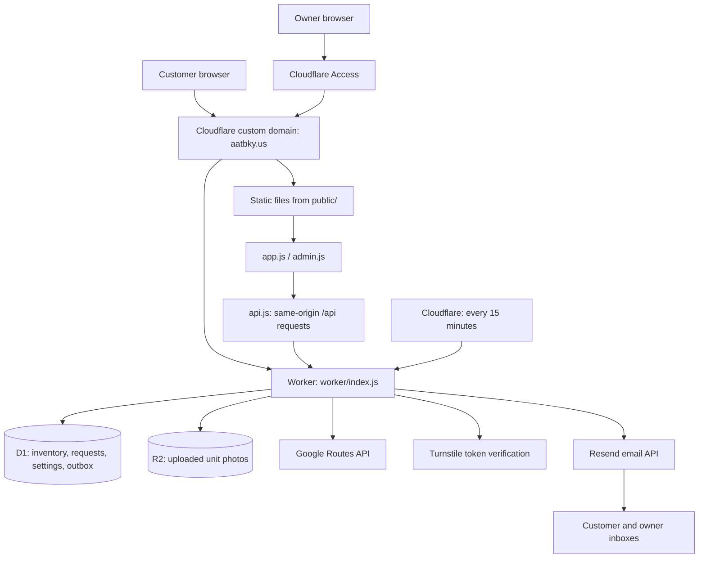
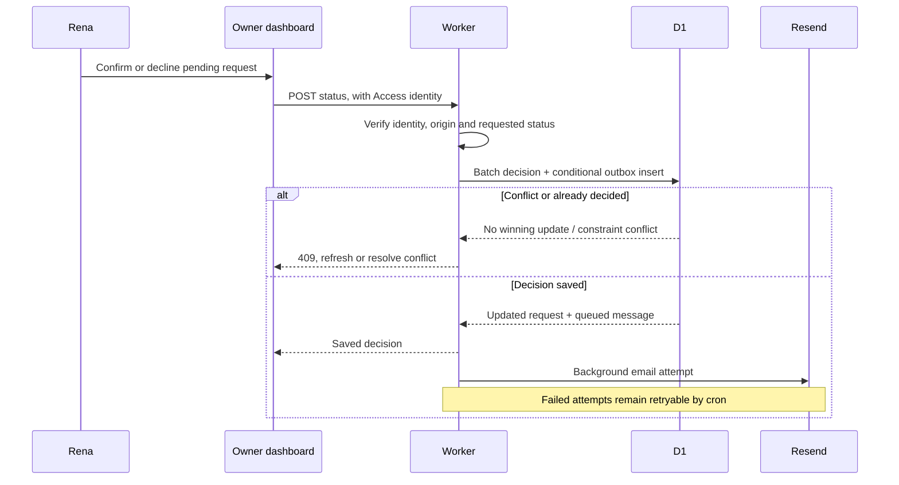

# All About That Bounce — architecture and project state

**Snapshot date:** October 15, 2026, America/New_York.  
**Production:** https://aatbky.us  
**Repository:** https://github.com/twinlakeswebco/allaboutthatbounce  
**Application source baseline for this document:** `eacd8bd056bb6604d07536eea4e529a90fd9ea0b`.

This document explains the running application, where its files and data live, how customer requests become confirmed rentals, and what is still unfinished. It is intended for both the business owners and the next developer.

Repository state, deployed state and verified behavior are separate. At this snapshot, `main` includes the new Matthew/Rena photograph, while production is still the earlier `d6bf36c` deployment. Email automation is implemented and configured, but actual customer/owner inbox delivery has not yet been verified with a complete production booking.

## Contents

1. [What the application does](#1-what-the-application-does)
2. [System overview](#2-system-overview)
3. [Hosting, accounts and resources](#3-hosting-accounts-and-resources)
4. [Where the files live](#4-where-the-files-live)
5. [Frontend](#5-frontend)
6. [Worker backend and HTTP API](#6-worker-backend-and-http-api)
7. [Booking and availability](#7-booking-and-availability)
8. [Automatic email and Resend](#8-automatic-email-and-resend)
9. [Delivery quotes](#9-delivery-quotes)
10. [Database and photo storage](#10-database-and-photo-storage)
11. [Security and configuration](#11-security-and-configuration)
12. [Scheduled work and retention](#12-scheduled-work-and-retention)
13. [Local development, testing and deployment](#13-local-development-testing-and-deployment)
14. [Current project state](#14-current-project-state)
15. [Remaining work and handoff](#15-remaining-work-and-handoff)
16. [Where to make common changes](#16-where-to-make-common-changes)

## 1. What the application does

All About That Bounce is an inflatable-rental business owned by Matthew and Rena Arnold. Rena is the direct customer contact and reviews rental requests. The stated service area is Oldham, Shelby, Henry, Trimble and Jefferson counties, Kentucky.

Customers can browse available inflatables, choose a date, request a delivery quote, submit a rental request, or send a contact message. The owner dashboard manages requests, inventory, photos, delivery settings and unavailable dates.

A customer submission is a **request**, not an automatically accepted reservation. Pending requests do not hold dates. Rena confirms or declines each request; the system then queues the appropriate customer email. Payment is cash or check at delivery. There is no advance deposit or online payment integration.

Business contact details:

| Channel                    | Current value                                |
| -------------------------- | -------------------------------------------- |
| Email and customer replies | `allaboutthatbounce7596@gmail.com`           |
| Phone                      | `502-851-7596`                               |
| Facebook                   | `Allaboutthatbounceky`                       |
| Instagram                  | `allaboutthatbounce502`                      |
| Notification sender        | `All About That Bounce <bookings@aatbky.us>` |

The notification sender is a verified sending identity. It is separate from the Gmail inbox the business uses for conversations.

## 2. System overview

The site is a small full-stack application: a plain browser frontend and a JavaScript backend deployed together as one Cloudflare Worker with static assets. There is no frontend compilation/build step, application framework, CMS, always-running server or browser-local database.



The HTML, CSS and browser JavaScript are public files. Business data comes from the Worker API. D1 holds structured records; R2 holds uploaded image bytes. External services provide road-distance calculation, bot verification and email transport.

The browser calls relative URLs such as `/api/units`. These requests stay on `aatbky.us`; the browser does not receive provider API keys or connect directly to D1, R2 administration, Google Routes or Resend.

## 3. Hosting, accounts and resources

### Production hosting

Production is **Cloudflare Workers with static assets**, using the `allaboutthatbounce` Worker. GitHub stores source and runs tests; it does not serve the complete production application.

[wrangler.jsonc](wrangler.jsonc) is the checked-in deployment configuration.

| Resource                       | Configured value                                 |
| ------------------------------ | ------------------------------------------------ |
| Production/custom domain       | `aatbky.us`                                      |
| Cloudflare business account    | `714af045eb67c3d815a7f9551b61d21b`               |
| Worker name                    | `allaboutthatbounce`                             |
| Worker entry point             | `worker/index.js`                                |
| Production compatibility date  | `2026-10-14`                                     |
| Static asset directory/binding | `./public` / `ASSETS`                            |
| D1 database/binding            | `allaboutthatbounce` / `DB`                      |
| D1 database ID                 | `bf86a18d-0ab6-485d-8c89-ffe91e1ff8c3`           |
| R2 bucket/binding              | `allaboutthatbounce-photos` / `PHOTOS`           |
| Scheduled trigger              | `*/15 * * * *` — every 15 minutes                |
| Access team hostname           | `all-about-that-bounce-llc.cloudflareaccess.com` |
| Alternate Worker hosts         | `workers_dev: false`, `preview_urls: false`      |

These resource identifiers identify infrastructure; they are not credentials. The private delivery origin and all API secrets are deliberately absent from this document.

### Static routing

Cloudflare static asset handling serves the HTML pages and local assets. `html_handling: auto-trailing-slash` supplies HTML routing; the canonical public URLs are `/`, `/about`, `/book` and `/contact`. Existing navigation uses `.html` links, which static asset handling resolves.

`/api/*` and `/media/*` are configured with `run_worker_first`, so the backend handles them before static asset lookup. `worker/index.js` also delegates non-API/non-media requests to the `ASSETS` binding when it receives them. Unknown assets are not configured to become a homepage fallback (`not_found_handling: none`).

The former homepage rewrite in `public/_redirects` was removed because it caused a redirect loop. It is not needed to serve `/`.

### External services and previews

- **Resend:** transports notification emails. `aatbky.us` has been verified in the Resend team used during setup. A future handoff to Rena has been discussed but not performed.
- **Google Routes API:** calculates driving distance from the secret delivery origin.
- **Cloudflare Turnstile:** supplies/validates bot-verification tokens for public forms. The production widget is configured for `aatbky.us`.
- **Cloudflare Access:** protects the owner page and admin API at the edge, with additional API-side JWT checks.

The GitHub Pages preview workflow was removed in PR #16 because static Pages hosting cannot run this backend. Removing that workflow does not itself delete a historical Pages deployment. Any future functional preview needs a separate Worker with isolated data, storage, secrets and access configuration. There is no separately configured staging environment in the current Wrangler file.

## 4. Where the files live

### Source checkout and GitHub

The working checkout on Casey’s computer is:

```text
/Users/casey/Documents/web-dev/allaboutthatbounce
```

Its Git remote is:

```text
https://github.com/twinlakeswebco/allaboutthatbounce.git
```

Git commits and pull requests preserve the application source. Editing a file locally, pushing a commit or merging a PR does not update production by itself. Production changes when the Worker is manually deployed.

### Repository map

```text
allaboutthatbounce/
├── architecture.md                This system map and dated state snapshot
├── PRODUCT.md                     Business constraints, audience, decisions
├── DESIGN.md                      Working visual system and historical UI review
├── BACKEND.md                     Infrastructure/setup and operational notes
├── README.md                      Developer entry point and API overview
├── TEST-RESULTS.md                Verification evidence and historical snapshots
├── wrangler.jsonc                 Worker, assets, bindings, variables, cron
├── package.json                   Check/development dependency definitions
├── package-lock.json              Reproducible dependency versions
├── vitest.config.mjs              Worker test environment and fake bindings
├── test-api.mjs                   GET-only smoke test against a running site
├── public/                       Public website assets only
│   ├── index.html                 Home/catalog entry point
│   ├── about.html                 Owners, business information and policies
│   ├── book.html                  Rental request flow
│   ├── contact.html               Contact form and business contact information
│   ├── admin.html                 Access-protected owner dashboard shell
│   ├── app.js                     Shared/public UI and form behavior
│   ├── admin.js                   Dashboard behavior
│   ├── api.js                     All browser API calls
│   ├── styles.css                 Shared styling, tokens, responsive layout
│   ├── _headers                   Static security/cache/indexing headers
│   ├── assets/                    Checked-in logo, marketing photos, owners photo
│   ├── share.svg / share.png      Editable social card and 1200×630 raster export
│   └── favicon.svg / placeholder.svg
├── worker/
│   ├── index.js                   Routing, persistence, booking decisions, cron
│   ├── access.js                  Access JWT verification and admin write guards
│   ├── distance.js                Google Routes calls, caching and delivery fee
│   ├── email.js                   Message content, outbox and Resend delivery
│   ├── storage.js                 R2 image upload/retention/media responses
│   └── validation.js              Input, money, date and response helpers
├── migrations/
│   ├── 0001_init.sql              Initial tables and constraints
│   └── 0002_decision_token.sql    Decision token used for race-safe notifications
├── seeds/
│   ├── seed_sample.sql            Local sample inventory only
│   └── seed_catalog_review.sql    26 old-site listings for local owner review
├── tests/                         Worker/Miniflare tests, mocks and runtime notes
├── frontend-tests/                Node/jsdom browser-module and email regressions
└── .github/workflows/tests.yml    CI: clean install, format check, tests
```

`public/assets/matt-rena.png` is the owners photograph added in `eacd8bd`; that source change is not in the verified live deployment at this snapshot.

### Local/generated/reference files

| Location                  | Purpose and handling                                                                 |
| ------------------------- | ------------------------------------------------------------------------------------ |
| `node_modules/`           | Installed development dependencies; regenerate with `npm ci`, not source control     |
| `.wrangler/`              | Local Wrangler state/cache, including local simulated storage; not production data   |
| `aatb-website-reference/` | Capture of the previous public site; ignored, reference-only, never commit or deploy |
| `private/`, PDFs          | Ignored private/reference material; never serve from `public/`                       |
| `.claude/worktrees/`      | Retained historical linked checkouts, currently detached; not production hosting     |
| `.impeccable/`            | Design tooling/context; generated design metadata may lag edited design notes        |

This chat also has a **separate project mirror**:

```text
/Users/casey/.codex/.chatgpt-projects/g-p-6acfb04680c481918d0a7cae5cacaffc
```

That mirror contains read-only synced material under `sources/` and local review/deployment artifacts from this chat. It is not the application checkout or a production asset directory. Synced source files may be replaced by project synchronization and must not be edited, renamed, moved or deleted.

### Where production data lives

D1 records and uploaded R2 unit photos live in Cloudflare, separately from GitHub and the laptop checkout. They are not included in a source checkout. Checked-in marketing images under `public/assets/` are a different class of asset: they ship with a deployment. Uploading a catalog photo through admin writes R2 and D1, not a new Git commit.

Only `public/` is published as static assets. Do not change the asset directory to the repository root; that would expose material that is not intended to be public.

## 5. Frontend

The frontend is plain HTML, CSS and vanilla JavaScript ES modules. There is no React/Vue application, frontend bundler, CMS dependency or downloaded font. Turnstile is the only external browser script. Styling is mobile-first, targeting a usable 360px-wide layout with larger-screen arrangements above the shared breakpoint.

[public/app.js](public/app.js) supplies shared helpers and public behavior: menu control, unit cards, selection, date picker, delivery quoting, validation, form submission and status/error messages. [public/admin.js](public/admin.js) loads owner data and handles request decisions, inventory changes, photo selection, settings and calendar blocks.

[public/api.js](public/api.js) is the only browser data-access layer. UI modules call functions such as `listUnits`, `getDeliveryQuote` and `setBookingStatus` instead of constructing endpoint requests throughout the interface. The wrapper handles JSON bodies and checks content type and response shape. HTML returned by a broken static preview or an expired Access session is treated as unavailable service, not a successful API result.

Booking data is not persisted in localStorage. The booking form keeps its current quote, selected unit/date and generated idempotency key in page memory; authoritative records are on the server. Changing the address invalidates the previous displayed quote. The form collects the Turnstile token and hidden honeypot value when submitting, then resets the widget after an attempt.

[public/styles.css](public/styles.css) holds shared colors at the top and the common layout/component rules. The working palette and logo are still provisional business decisions. Public pages have canonical/Open Graph URLs on `aatbky.us`, a local social share graphic, and shared Facebook/Instagram/contact links. Header/footer markup is duplicated across HTML files; common navigation/footer changes must therefore be applied to every page.

## 6. Worker backend and HTTP API

[worker/index.js](worker/index.js) exports a `fetch` handler for HTTP requests and a `scheduled` handler for background work. Routing is implemented directly with paths and regular expressions, without a routing framework. D1/R2 are accessed through Worker bindings rather than credentials sent by the browser.

| Method | Route                                      | Purpose/access                                               |
| ------ | ------------------------------------------ | ------------------------------------------------------------ |
| GET    | `/api/units`                               | Public active inventory, dollar prices and photo URLs        |
| GET    | `/api/settings`                            | Public delivery settings                                     |
| GET    | `/api/units/:id/blocked-dates`             | Public future/today manual blocks and confirmed dates        |
| POST   | `/api/delivery-quote`                      | Public address-to-distance/fee calculation, rate-limited     |
| POST   | `/api/booking-requests`                    | Public pending request, Turnstile/honeypot/rate-limit checks |
| POST   | `/api/contact`                             | Public contact message with matching form protections        |
| GET    | `/api/admin/booking-requests`              | Owner request list                                           |
| PUT    | `/api/admin/settings`                      | Owner delivery-setting update                                |
| POST   | `/api/admin/booking-requests/:id/status`   | Owner confirm/decline action                                 |
| POST   | `/api/admin/units`                         | Owner unit creation                                          |
| PUT    | `/api/admin/units/:id`                     | Owner unit/photo update                                      |
| DELETE | `/api/admin/units/:id`                     | Owner soft deletion, subject to future/today requests        |
| PUT    | `/api/admin/units/:id/blocked-dates/:date` | Owner manual date block                                      |
| DELETE | `/api/admin/units/:id/blocked-dates/:date` | Owner manual unblock, excluding confirmed rentals            |
| GET    | `/media/:key`                              | Public image bytes fetched from R2                           |

All admin API actions pass JWT/allowlist checks. Mutating admin actions also require the configured site origin and JSON content type. Failures use JSON errors; the outer handler returns a generic 500 message for unexpected exceptions.

## 7. Booking and availability

### Customer submission

1. The browser loads active units and delivery settings, then unavailable dates for the selected unit.
2. The customer selects a date and requests a quote for the delivery address.
3. The request includes unit/date, name, phone, email, event type, delivery address, a generated idempotency key, a Turnstile token and an empty honeypot.
4. The Worker checks the rate bucket, token hostname/action, honeypot and required inputs.
5. It looks for a prior submission with the same idempotency key. A matching-email retry returns that saved request; reuse with a different email is rejected.
6. It reloads the unit and availability, recalculates delivery, and computes the total from server-side prices in cents. Client-supplied totals are not trusted.
7. A D1 batch saves the pending request and two outbox records: owner notification and customer acknowledgement.
8. The Worker schedules email attempts with `ctx.waitUntil` and returns the saved request. A 201 response means saved/queued, not delivered or confirmed.

### Owner decision

Rena opens `/admin.html`, signs in through Access, and chooses **Confirm request** or **Decline request** on a pending request. The decision route accepts only those two outcomes and refuses a request that has already been decided.

For confirmation, the database update checks for a manual block. A partial unique index, `one_confirmed_per_unit_date`, prevents two confirmed bookings for the same unit/date. A new decision token ties the notification insert to the winning update, preventing a losing decision from queuing its email. The status change and matching notification insert are submitted in one D1 batch; conflicts return 409.



Availability is calculated from confirmed requests plus manual blocks. Pending requests never reserve a date. Declining a request does not block the calendar. A confirmed rental cannot be undone by the manual-unblock action. The current interface has no general customer account, cancellation/rebooking workflow or multi-unit cart; a request covers one unit on one event date.

Date comparisons that determine today/future use America/New_York. Prices are integer cents in D1 and dollar numbers at the public API boundary. Booking rows retain unit-name/price snapshots so later inventory edits do not rewrite historical quotes.

## 8. Automatic email and Resend

[worker/email.js](worker/email.js) builds both plain-text and escaped HTML emails and sends them through `POST https://api.resend.com/emails`.

| Trigger            | Recipient   | Subject/content                                                                 |
| ------------------ | ----------- | ------------------------------------------------------------------------------- |
| New rental request | Owner Gmail | New booking request, details, quote, dashboard link; replies go to customer     |
| New rental request | Customer    | “Booking request received”; explicitly still awaiting confirmation              |
| Owner confirms     | Customer    | “Booking confirmed”; unit, date, total and delivery/payment/setup information   |
| Owner declines     | Customer    | “Booking request update”; polite decline and invitation to discuss alternatives |
| Contact form       | Owner Gmail | “Website contact message”; replies go to the sender                             |

The sender is `All About That Bounce <bookings@aatbky.us>`. For customer notifications, Reply-To defaults to `allaboutthatbounce7596@gmail.com`; owner/contact notifications preserve the customer’s address. Receiving mail for the sending domain is not enabled in the Resend setup. Customers should reply to the configured Gmail address, not rely on a mailbox existing at the sender address.

### Outbox and retries

D1’s `notification_outbox` holds recipient, reply address, subject, HTML/text, status, attempt count and last error. Messages begin pending. An immediate background attempt runs after the associated action; unsuccessful sends become failed and remain eligible for retry.

Every 15 minutes, the scheduled handler selects up to 50 pending/failed messages with fewer than five attempts. After five attempts, the current code stops retrying that row. If `RESEND_API_KEY` is absent, the normal sender returns without spending attempts.

A successful provider HTTP response marks the row `sent`. That means **Resend accepted the send request**, not that the recipient’s inbox received it. The current implementation does not store the returned provider email ID, process delivery/bounce webhooks, or show provider-delivery tracking in admin. Booking idempotency and conditional decision inserts prevent duplicate outbox creation in the tested cases; they are not a provider-level exactly-once-delivery guarantee.

The automated confirm/decline workflow is implemented and deployed. Domain verification, DNS records and secret-name presence have been checked. Actual production customer/owner inbox delivery is still awaiting a controlled test.

## 9. Delivery quotes

[worker/distance.js](worker/distance.js) asks Google Routes for driving distance from `ORIGIN_ADDRESS` to the submitted destination. The origin is a Worker secret and must never appear in source, browser responses, fixtures, documentation or logs. The Google request uses the Routes API key, driving mode, a distance-only field mask and a five-second abort timer.

Destination strings are normalized and SHA-256 hashed for the D1 quote cache. Cached distances are reused for up to 30 days. The cache stores the hash and distance, not the raw destination. A saved booking separately retains its delivery address for fulfillment.

Current settings, also confirmed by the live API:

| Setting          | Value                    |
| ---------------- | ------------------------ |
| Free radius      | 15 miles                 |
| Per-mile rate    | $0.35                    |
| Trip multiplier  | 4                        |
| Maximum distance | None configured (`null`) |

Within the free radius, delivery is free. Outside it, the fee uses the **full distance**, not just miles beyond the free radius:

```text
fee = full one-way driving distance × per-mile rate × trip multiplier
16 miles × $0.35 × 4 = $22.40
20 miles × $0.35 × 4 = $28.00
```

Distance is rounded to tenths before the fee calculation; money is rounded in cents. A configured maximum is checked before the free/paid result. `outside_area` returns zero as a sentinel, and the browser prevents submission; zero in that state does not mean free delivery.

Unresolvable addresses return an actionable error; provider failures return a temporary-unavailability response rather than an invented distance. The five-county service area is business policy: the API does not currently validate county membership. Rena must check eligibility when accepting requests. A real locality-level La Grange, KY quote has succeeded; precise address accuracy and the Google key’s API restrictions have not been audited.

## 10. Database and photo storage

### D1 data model

The numbered migrations define these application tables:

| Table                 | Stored information                                                                                                            |
| --------------------- | ----------------------------------------------------------------------------------------------------------------------------- |
| `units`               | Name, description, dimensions/spec text, wet/dry mode, price cents, deposit-notice flag, sort order, soft-delete/timestamps   |
| `unit_photos`         | Unit association, R2 object key and display position                                                                          |
| `settings`            | Single delivery-setting row, last updater/time                                                                                |
| `blocks`              | Unit/date manual blocks with creator/time; composite primary key                                                              |
| `booking_requests`    | Customer/event details, unit and quote snapshots, status, idempotency key, decision identity/time/token, anonymization marker |
| `quote_cache`         | Destination hash, calculated distance, cache timestamp                                                                        |
| `contact_messages`    | Name, email, message and received time                                                                                        |
| `notification_outbox` | Durable notification payload, status, attempts and errors                                                                     |
| `rate_limits`         | HMAC IP bucket, hourly window and request count                                                                               |

`0001_init.sql` creates the initial schema, unique idempotency key and one-confirmed-per-unit/date index. `0002_decision_token.sql` adds the decision token. The last explicitly approved production migration-status check reported no pending migrations. No seed was run remotely.

### R2 unit photos

Admin submits selected photos as image data URLs, or retains existing `/media/...` URLs. The Worker accepts up to five photos per unit, at most 1 MB each, and checks PNG/JPEG/WebP magic bytes. It generates object keys, writes bytes and content type to R2, then stores the ordered references in D1.

The media route reads R2 and returns the image with its metadata, ETag and a one-year immutable cache header. Unit photos are publicly viewable; uploading/replacing/removing them is an authenticated owner action. Removing/replacing photos cleans up corresponding old R2 objects. R2 writes and D1 metadata changes are separate service operations, not one cross-service transaction.

Unit removal is a soft delete. Pending or confirmed bookings dated today or later prevent removal. When allowed, the unit is hidden from the active catalog, its photo rows/R2 objects and manual blocks are removed, and historical request snapshots remain.

### Catalog review data

The 26 listings in `seeds/seed_catalog_review.sql` are captured claims from the old site, not approved production inventory. Both that file and `seed_sample.sql` are **local-only**. Owner approval allows entering confirmed listings through admin; it does not authorize remote seeding.

The current model supports one price and one wet/dry mode per unit. Some source prices describe an add-on or smaller configuration. For example, the lowest price for a large slide package may cover only the slip-and-slide portion. Those prices must not be published as full-package prices. Separate listings for configurations of one physical unit would need shared availability before they are safe to publish.

## 11. Security and configuration

### Owner access

Cloudflare Access is configured for `/admin.html` and `/api/admin/*`. Unauthenticated requests to the tested paths redirect to the Access team. The Worker then verifies `Cf-Access-Jwt-Assertion`: RS256 signature, key ID, issuer, configured audience, numeric expiry, optional not-before, and the email allowlist. Public certificate keys are cached for one hour.

Admin POST/PUT/DELETE actions require JSON content type and an Origin equal to `SITE_ORIGIN`. The browser has no custom password database or login implementation. Changing owner access may require changes to both Cloudflare Access policy and `ADMIN_EMAILS`.

The current source permits `DEV_ADMIN_EMAIL` only on `localhost` or `127.0.0.1`. This local development bypass is not a production authentication method and must not be configured for production.

### Public form protections

Turnstile verification checks success, production hostname and the correct action (`booking` or `contact`). A hidden `website` field acts as a honeypot. Rate limits use HMAC-SHA-256 of the request IP rather than storing raw IP addresses in the rate-limit table. Buckets are per action and hour: 60 quote requests, 10 booking requests and 5 contact messages per IP bucket. These are request limits, including attempted submissions, not guaranteed accepted-message counts.

[public/_headers](public/_headers) sets CSP, nosniff, referrer and browser-permission restrictions. Admin HTML has noindex/nofollow and no-store rules. Headers complement authentication; noindex alone does not protect private pages.

### Variables versus secrets

Non-secret configuration lives in `wrangler.jsonc`: `OWNER_EMAIL`, `FROM_EMAIL`, `SITE_ORIGIN`, `ACCESS_TEAM_DOMAIN`, `ACCESS_AUD`, `ADMIN_EMAILS` and `TURNSTILE_SITE_KEY`. The public Turnstile key is also embedded in the booking/contact HTML; keep those copies aligned.

The five production secret names are:

| Secret                | Use                                          |
| --------------------- | -------------------------------------------- |
| `ORIGIN_ADDRESS`      | Private starting address for delivery routes |
| `GOOGLE_MAPS_API_KEY` | Worker-to-Google Routes authentication       |
| `RESEND_API_KEY`      | Worker-to-Resend sending authentication      |
| `TURNSTILE_SECRET`    | Server-side token verification               |
| `IP_HASH_SECRET`      | HMAC key for IP-derived rate buckets         |

All five names were verified as present. Their values were not read into this document or committed. Secret presence alone does not prove correct provider permissions or operation. Set/rotate secrets through the approved secure Worker-secret workflow, never by pasting values into Git, issue text, command arguments or chat.

## 12. Scheduled work and retention

The same Worker runs a scheduled handler every 15 minutes. In addition to email retries, it performs these cleanup operations:

| Condition                                   | Current cleanup                                                           |
| ------------------------------------------- | ------------------------------------------------------------------------- |
| Booking event date older than 12 months     | Clears name, phone, email and delivery address; sets anonymization marker |
| Contact message received over 12 months ago | Deletes message row                                                       |
| Sent outbox message older than 30 days      | Clears HTML, text, subject and Reply-To                                   |
| Rate-limit window older than 2 hours        | Deletes bucket row                                                        |

This is targeted cleanup, not complete deletion of all historical personal data. Booking rows, event type and financial/unit snapshots remain. The outbox cleanup does not clear `to_email`, and its body cleanup applies to sent rows, not all failed/pending rows. Quote-cache lookups ignore distances older than 30 days, but the scheduled handler does not separately purge all stale cache rows. These distinctions matter when reviewing future retention requirements.

## 13. Local development, testing and deployment

### Local operation

From the checkout, use Node 22 or newer:

```sh
npm ci
npx wrangler d1 migrations apply allaboutthatbounce --local
npx wrangler dev
```

Open the local URL Wrangler prints. Local D1/R2 simulation is separate from production. A static file server can preview HTML/CSS but cannot exercise the API, real persistence or scheduled work. Tests override all service variables/secrets with fake bindings; local interactive use needs its own deliberately configured development values.

### Automated verification

```sh
npm run format:check
npm test
```

CI runs the same clean install, formatting check and tests for pull requests to `main` and pushes to `main`, using Node 22. It does not deploy. `npm test` runs:

- **94 Worker tests** using Vitest/Miniflare, isolated local D1/R2, the real numbered migrations and mocked outbound providers.
- **15 frontend/email tests** using Node’s test runner and jsdom, actual page modules, stubbed browser requests, and mail-content/reply-routing checks.

The latest full merged application check passed all **109 tests**. GitHub CI also passed on the newer `eacd8bd` owners-photo commit. This documentation-only change does not alter application behavior.

Tests cover money/delivery boundaries, rate limits, idempotency, availability/decision races and rollback, JWT validation, write guards, image checks, deletion, outbox/retries, retention, frontend fallbacks and email escaping/reply routing. Unmocked outbound Worker networking is disabled. Passing mocks are not evidence that real emails reached inboxes.

The lockfile currently pins `@cloudflare/vitest-pool-workers` 0.12.21 with Vitest 3. Its workerd supports compatibility dates through `2026-03-10`, so tests still fall back from production’s `2026-10-14` date. The newer Vitest/plugin integration removes `fetchMock` and changes isolation/configuration; adopting it needs a separate harness migration. Dependency advisories remain; the runtime upgrade was not a complete security-remediation effort. See [tests/README.md](tests/README.md).

A running local or production site can receive the GET-only smoke test:

```sh
npm run test:smoke
API_BASE_URL=https://aatbky.us npm run test:smoke
```

It checks units, settings and blocked dates. It can pass against an empty catalog and does not test a real booking, photo upload, login or inbox receipt.

### Deployment and approval rules

Use a branch and PR for each logical repository change. Obtain explicit confirmation before merging, deploying or running **any remote D1 command**, including read-only migration listing. A previous approval for one deployment does not authorize every future change.

Prepare/review first, run the applicable checks, then ask approval for the exact change. Once deployment is approved, `npx wrangler deploy` packages the Worker and uploads static files from `public/`. There is no frontend build command and no automatic deployment on merge. D1 migrations are a separately approved operation; deployment must not silently apply them or load a seed.

After deployment, record the Git revision and Cloudflare Worker version, run the public API smoke test, inspect changed page content/assets, and confirm unauthenticated admin requests still redirect to Access. A Worker version UUID and a Git commit hash are different identifiers; record their association rather than treating them as interchangeable.

## 14. Current project state

### Source and deployed versions

| Item                                       | State at this snapshot                                                                                        |
| ------------------------------------------ | ------------------------------------------------------------------------------------------------------------- |
| Source `main` baseline                     | `eacd8bd056bb6604d07536eea4e529a90fd9ea0b` — owners photo added                                               |
| Last approved/deployed source              | `d6bf36c7172b39abdaa9e3b87e2f8753c5090c3e` — merged PRs #16–#19                                               |
| Active Worker version                      | `20460f53-4d4a-4ccb-81c4-115d2bcf05ce`, 100% of traffic                                                       |
| Active deployment time                     | October 15, 2026, 5:35 p.m. Eastern, from deployment history                                                  |
| Owners photo                               | Present in source at `public/assets/matt-rena.png`; absent from the live About HTML checked for this document |
| GitHub status before this documentation PR | No other open PRs; no open issues; `main` CI green                                                            |

The difference between current `main` and the live application is the owners-photo HTML/CSS/image change. It has not been deployed by this documentation task.

### Implemented, configured and verified

| Area                      | Current evidence                                                                                             |
| ------------------------- | ------------------------------------------------------------------------------------------------------------ |
| Public site               | Live; About shows “Meet the Arnolds.” and names Rena as direct contact                                       |
| Canonical/social URLs     | Corrected to `aatbky.us`; deployed and previously checked on all four public pages                           |
| Share image and Instagram | New image and shared Instagram links deployed and verified                                                   |
| Admin protection          | Live `/admin.html` and tested admin API requests return 302 to Access; rechecked for this document           |
| Catalog                   | Live `/api/units` still returns `[]`; entry deliberately deferred                                            |
| Delivery settings         | Live defaults: 15 free miles, $0.35/mile, ×4 multiplier, no maximum; rechecked                               |
| Migration status          | Last approved remote listing reported no migrations to apply; no new remote D1 command run for this document |
| Turnstile                 | Production hostname configuration checked; complete real-token booking not yet tested                        |
| Resend                    | Domain and three sending DNS records verified; key stored; verified sender/Reply-To code deployed            |
| Decision emails           | Confirmation and decline automation implemented; tests pass; actual inbox receipt remains unverified         |
| Secrets                   | All five required names previously verified present; values not exposed                                      |
| Google Routes             | A real locality-level quote succeeded; restrictions and address accuracy remain unverified                   |
| R2 photos                 | Upload/media/cleanup behavior covered locally; real production upload/retrieval not yet verified             |
| Tests                     | 109 passed on deployed application; latest source CI green; runtime-date limitation remains                  |
| GitHub Pages preview      | Publishing workflow removed; historical deployment removal not verified                                      |
| Branch housekeeping       | Old merged branches removed after ancestry checks; historical worktree files preserved                       |
| Brand                     | Working logo and palette remain provisional                                                                  |

### Older documentation snapshots

`README.md`, `PRODUCT.md`, `BACKEND.md` and `TEST-RESULTS.md` contain useful implementation/setup information but also dated status paragraphs. Some still say PR #18 is awaiting deployment or describe the sender/social image as placeholders. Those statements predate the approved `d6bf36c` deployment and do not describe the current live configuration. PRs #1–#19 are merged. Use the dated deployment evidence and current configuration when reconciling these historical snapshots.

This document is also a snapshot. Update this section after subsequent deployments or production verification; do not infer current deployment merely from the newest Git commit.

## 15. Remaining work and handoff

The main remaining launch work is operational verification and approved inventory, not building the basic confirm/decline email feature.

1. **Catalog approval and entry:** obtain Rena/Matthew’s approved inventory, prices/configurations, dimensions, capacities, supervision requirements and matching photos. Enter approved units through admin. This work is currently deferred; never run the review seed remotely.
2. **Controlled production booking/email test:** once a real approved unit is available, verify public submission with a real Turnstile token, owner receipt, customer acknowledgement, confirmation and decline outcomes using separate pending requests, and actual inbox/provider results. Do not manufacture public inventory or confirm a genuine customer’s request merely to test.
3. **Remaining service checks:** inspect Google Routes key restrictions in Google Cloud, validate an approved real delivery destination, test authorized production photo upload/retrieval and owner access. Secret-name presence and mock tests do not replace these checks.
4. **Owners-photo release:** the `eacd8bd` source change has green CI but is not live. Deployment needs explicit approval.
5. **Rena handoff:** decide the final Resend team/account ownership and access. Confirm her Access sign-in/policy and email allowlist before relying on owner-dashboard access. Do not share Casey’s personal login credentials.
6. **Maintenance:** review remaining dependency advisories and plan a separate migration to the newer test integration if full production-date coverage is needed. Refresh stale status paragraphs and generated design metadata when requested.
7. **Business/brand decisions:** finalize the working logo/palette and any remaining catalog options. Shared availability for alternate configurations needs model/booking changes before publishing multiple listings for a single physical unit.

The configuration file does not define staging or a backup/export schedule. Production recovery/backup arrangements were not audited in this work; do not assume a Git checkout includes database records or R2 uploads.

## 16. Where to make common changes

| Desired change                                       | Main files or service                                                                |
| ---------------------------------------------------- | ------------------------------------------------------------------------------------ |
| Home/About/contact marketing copy                    | Corresponding `public/*.html`; preserve approved business facts                      |
| Owner photo or logo                                  | `public/assets/`, consuming HTML, related `public/styles.css` rules                  |
| Shared navigation/footer                             | All five HTML pages; markup is duplicated                                            |
| Colors, spacing, responsive layout                   | `public/styles.css`, plus design notes when appropriate                              |
| Social preview                                       | Metadata in each HTML page; `public/share.svg` source and `share.png` export         |
| Customer form/calendar behavior                      | `public/app.js`, with requests through `public/api.js`                               |
| Dashboard behavior/status messages                   | `public/admin.js` and `public/admin.html`                                            |
| Confirm/decline email wording                        | `worker/email.js` and email regressions                                              |
| Sending identity/domain                              | Reviewed `FROM_EMAIL` change, Resend verification and any exact approved DNS records |
| Owner receiving/reply inbox                          | `OWNER_EMAIL`; verify intended contact copy and reply-routing tests                  |
| Prices, catalog photos, blocks and delivery settings | Protected admin UI → D1/R2; usually no source deployment required                    |
| Availability, request persistence, decisions         | `worker/index.js`, D1 migrations if schema changes, Worker tests                     |
| Delivery fee/provider behavior                       | `worker/distance.js` and boundary/provider tests                                     |
| Admin identities/policy                              | Cloudflare Access policy plus `ADMIN_EMAILS`; Worker checks in `access.js`           |
| Secrets                                              | Cloudflare Worker secrets, using the secure approved workflow                        |
| Schema                                               | New numbered migration, local tests, separately approved production migration        |
| CI/test dependencies                                 | `.github/workflows/tests.yml`, test configuration, package files                     |
| Deployment domain, resources or cron                 | `wrangler.jsonc`, corresponding Cloudflare configuration and verification            |

Source files and configuration explain how the application is intended to work. Production checks establish what is actually running. Keep both in the handoff record.
